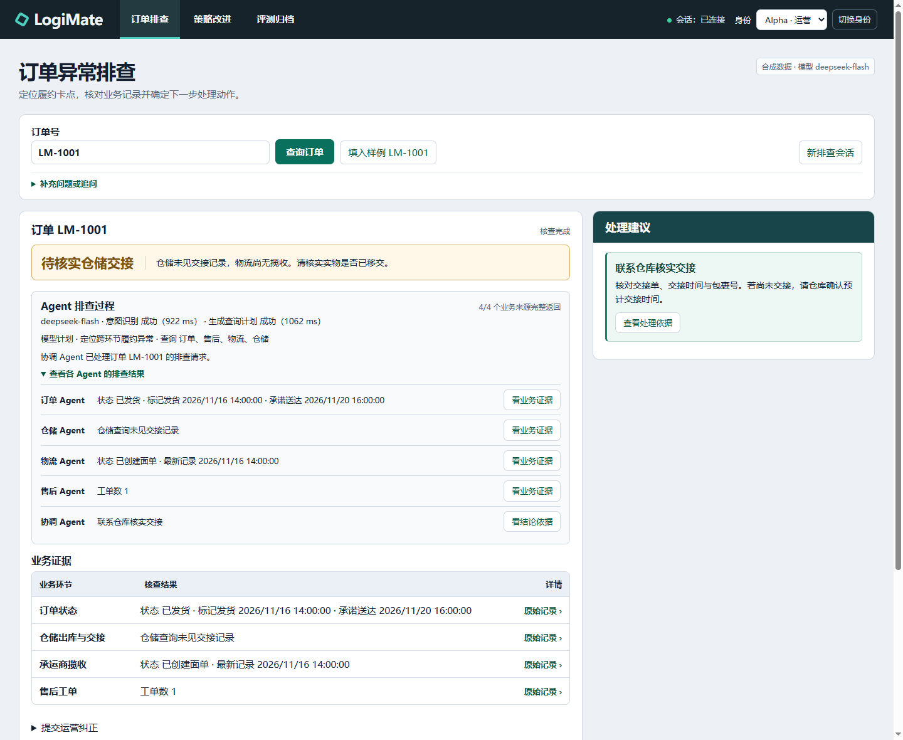
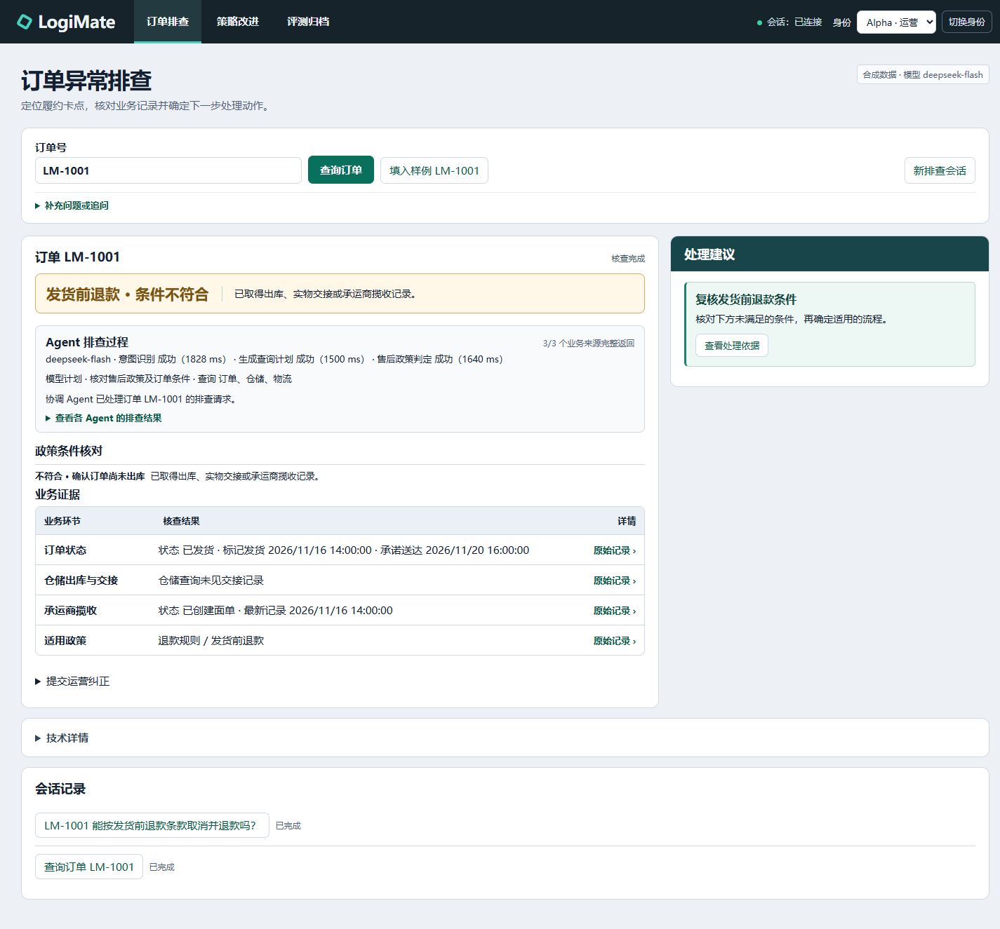
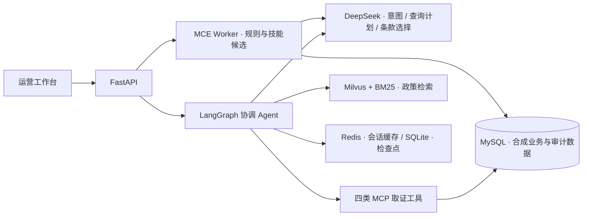

# LogiMate

**面向供应链运营人员的多 Agent 异常排查工作台。** 输入订单号或自然语言问题，查看卡点、下一步处理建议，以及订单、仓储、物流和售后系统返回的证据。



截图来自本地工作台的真实 DeepSeek API 调用与 MCP 查询。订单、政策及运营反馈使用合成数据。

[快速启动](#本地运行) · [评测结果](#评测结果) · [技术设计](docs/technical/architecture.md) · [接口文档](docs/api/README.md)

## 工作台能做什么

- **跨系统查单。** 协调 Agent 使用 DeepSeek 识别意图并规划查询。应用校验计划、绑定订单与包裹参数，再用 LangGraph 调度订单、仓储、物流和售后 Agent。每次查询可核对模型调用、MCP 工具耗时及原始记录。
- **核对售后政策。** Milvus 向量与中文 BM25 双路召回，RRF 融合。DeepSeek 从检索结果选择条款，程序按实际出库、交接和揽收证据逐项核对，列出不满足的条件及待补材料。
- **改进排查策略。** 基础层根据已复核的运营纠正提出规则变更，元层从失败回放改进规则生成技能。候选经过独立回放与人工审核，可追溯、发布和回滚。
- **延续排查上下文。** Redis 缓存近期问题与预算内摘要，Milvus 召回用户主动保存的偏好，LangGraph 持久化检查点支持服务重启续跑。



在「补充问题或追问」中输入 `LM-1001 能按发货前退款条款取消并退款吗？`。这笔订单已有出库记录，工作台会展示已核对的条件，并链接到政策及业务记录。

## 技术架构



## 本地运行

以下命令在仓库根目录的 PowerShell 执行。需要 Python 3.12、uv、原生 MySQL 8 和 Redis。Milvus Lite 随项目依赖运行，首次建索引会下载中文编码模型。

**1. 准备数据和配置**

```powershell
uv sync --locked --python 3.12
Copy-Item .env.example .env
New-Item -ItemType Directory -Force .logimate | Out-Null
```

在 MySQL 创建专用数据库并为应用用户授权，然后在本机 `.env` 填写 `MYSQL_DSN`、`LOGIMATE_SESSION_SECRET`、`LOGIMATE_MCP_SIGNING_KEY` 和 `DEEPSEEK_API_KEY`。两个签名密钥独立生成，各至少 32 字符，模型默认使用 `deepseek-flash`。如果只需快速体验，可将 `MYSQL_DSN` 设为 `sqlite:///.logimate/logimate.db`。无密钥离线运行可将 `LOGIMATE_MODE` 设为 `demo`。

Windows 上若项目路径含中文，可将 Milvus Lite 指向已创建的英文目录，例如 `LOGIMATE_MILVUS_URI=C:/logimate-data/milvus.db`。如需在应用内浏览已归档报告，可设置 `LOGIMATE_EVALUATION_DIR=docs/qa/results`。 [完整配置](docs/technical/runbook.md#环境与配置)

```powershell
uv run --locked --env-file .env logimate migrate
uv run --locked --env-file .env logimate demo seed --data-version synthetic-v1
uv run --locked --env-file .env logimate index-policies --data-version synthetic-v1
```

**2. 启动三个原生进程**

分别在三个 PowerShell 窗口运行以下命令。第三条用于处理策略改进与回放任务。

```powershell
uv run --locked --env-file .env uvicorn logimate.mcp_service:create_app --factory --host 127.0.0.1 --port 8011
uv run --locked --env-file .env uvicorn logimate.api:create_app --factory --host 127.0.0.1 --port 8010
uv run --locked --env-file .env logimate worker
```

**3. 在工作台复现**

打开[本地工作台](http://127.0.0.1:8010/)，以「Alpha · 运营」查询样例 `LM-1001`。在「补充问题或追问」里试试 `LM-1001 只查订单状态`，然后展开「Agent 排查过程」查看本次计划，并在「技术详情」核对实际调用的工具。策略改进可按运行手册完成纠正、复核、回放与回滚。 [完整操作步骤](docs/technical/runbook.md#阶段-05-演示工作台) · [Swagger UI](http://127.0.0.1:8010/docs)

## 评测结果

冻结集使用合成数据。物流三组对同一批样本执行规则回放，固定技能与演化技能的规则候选由 DeepSeek 参与生成。售后问答按结构化政策动作评分。

| 实验 | 实测结果 |
| --- | --- |
| 物流诊断误判率，同一批 100 条案例 | 初始规则 **40%** → 固定技能 **36%** → 演化技能 **30%** |
| 售后 Recall@5，48 条有适用政策的问题 | BM25 **45/48**，纯向量与混合检索均为 **48/48** |
| DeepSeek 混合检索问答，60 条案例 | **56/60（93.33%）** |
| 证据校验对照，两组各 60 条 | 两组均未观测到无依据引用，校验组额外拒答 3 道可回答问题 |

[逐案例报告](docs/qa/results/README.md) · [评测复现步骤](docs/technical/runbook.md#评测用法) · [阶段验收与真实模型记录](docs/delivery/06-release.md)

## 文档与许可

- [产品需求](docs/product/prd.md) · [技术设计](docs/technical/architecture.md) · [本地运行手册](docs/technical/runbook.md)
- [HTTP 联调](docs/api/README.md) · [OpenAPI 合同](docs/api/openapi.yaml) · [MCP 工具合同](docs/api/mcp-tools.md)
- [验收用例](docs/qa/acceptance.md) · [六阶段交付](docs/delivery/README.md) · [开发协作约定](AGENTS.md)

项目采用 MIT 许可证。双层策略改进参考 Ye 等人的 MCE 论文并针对物流场景实现。 [MIT 许可证](LICENSE) · [MCE 论文](https://proceedings.mlr.press/v306/ye26g.html)
