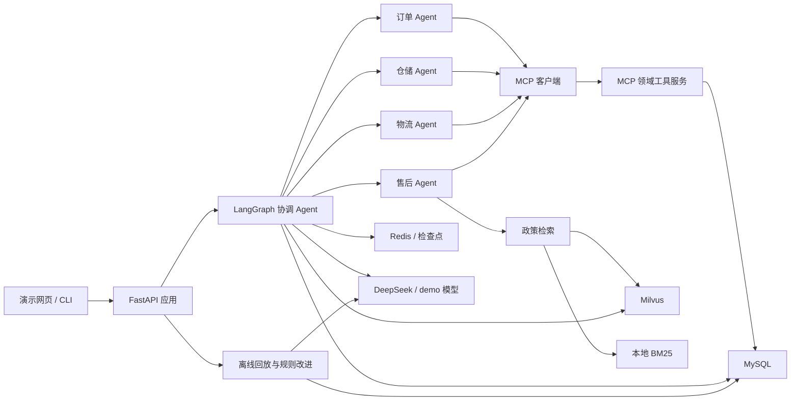

# LogiMate 开发规格

日期 2026-11-19 · 状态 已确认

需求、接口、实现和阶段证据的入口见[项目文档索引](../../../README.md#文档索引)。本规格保留已确认的范围和总体设计。

## 1. 项目目标与范围

LogiMate 是一个面向供应链运营人员的多 Agent 排查系统，也是一个可在本地运行和复测的 Agent 开发求职项目。运营人员用自然语言查询订单、仓储、物流和售后信息，得到带证据的异常结论或待核实项。纠正记录进入离线改进流程，经回放与人工审核后发布规则，线上排查可追溯所用版本。

已确认的交付范围包括五类 Agent、真实 MCP 协议调用及容错、物流排查双层改进、售后混合检索、分层持久记忆、轻量演示网页和自动化评测。业务记录、政策文档、运营反馈和评测案例全部合成。各阶段在本地实施并验收，全部交付条件满足后发布公开 GitHub 仓库。

业务接口提供只读查询。系统内的写入覆盖会话、用户明确保存的偏好、纠正、回放、审批及规则版本。初始交付环境是单机原生进程环境，所称的运营和审核身份属于演示环境。对接企业系统、商业部署和多实例高可用留作后续需求。

简历中的误判率 30% → 18%、幻觉率下降 40%–50%、召回率提升 30% 和问答准确率超过 95% 作为实验目标登记。项目交付时记录各项实际结果和评测条件。简历中的五套后台和超过 20 分钟属于场景设定，公开版提供合成领域服务与可测的本地耗时。

## 2. 设计选择

| 决策 | 采用方案 | 取舍 |
| --- | --- | --- |
| 展示形式 | FastAPI 同源提供轻量网页，附带 CLI 和 OpenAPI | 浏览器可直接演示，评测仍可脚本化。首版用 HTML、CSS 和原生 JavaScript，减少前端构建依赖 |
| MCE 集成 | 在 LogiMate 中实现论文的双层机制，归档版本化规则集和规则生成技能 | 作者仓库提供可扩展任务环境，适合论文实验。领域化实现便于限定产物格式、接入版本发布和审计，并单独说明与原论文的映射 |
| 数据与工具 | 合成业务库，上层通过实际 MCP 请求读入 | 可演示 schema、鉴权、超时、降级及权威证据。用例可按固定种子重建 |
| 运行模式 | 同一服务提供无密钥 demo 与可配置 DeepSeek 模式 | demo 用确定性模型适配器和可复现示例，验证完整产品链路。真实模型模式用于验证模型驱动的路由、输出和策略迭代 |
| 检索链路 | Milvus 稠密检索与本地中文 BM25 并发，RRF 融合 | BM25 索引从同版文档构建，可独立回退。融合和超时由应用层控制 |
| 持久化 | MySQL 保存业务与审计数据，Redis 保存热会话，Milvus 保存文档及长期偏好向量，SQLite 持久化图检查点 | SQLite 放在应用专用数据目录，服务单实例运行。重启续跑与业务审计有明确的持久化来源 |

初始化阶段验证并锁定 Python 3.12、FastAPI、LangGraph、MCP Python SDK、PyMilvus、`langgraph-checkpoint-sqlite` 与原生服务的兼容组合。DeepSeek 模型 ID 可配置，评测记录实际使用的模型。中文稠密向量采用可在 CPU 上运行的本地编码器，首选多语言 MiniLM 候选，实施时核验模型许可证、中文检索质量和容器内存。将可复现的模型版本和依赖写入锁文件或运行说明。

## 3. 业务场景与主线演示

| 场景 | 主要证据 | 预期行为 |
| --- | --- | --- |
| 订单是否发货 | 订单状态、仓库出库、包裹号 | 区分订单上的发货标记、仓库实际交接和承运商实际揽收 |
| 标签创建后迟迟无扫描 | 交接时间、承运商轨迹、模拟查询时点 | 区分尚未交接、已交接待揽收和承运商暂不可查 |
| 已揽收后轨迹停滞 | 承运商事件、线路时效、采购或发货承诺 | 标出超时或在途状态，解释阈值及例外依据 |
| 显示签收但用户未收到 | 签收事件、订单及工单记录 | 标记签收争议，给出核实动作和所需证据 |
| 退款或赔付条件 | 售后工单、订单状态、政策版本和正文引用 | 判断适用条款与前置条件，关键事实缺失时说明所缺信息 |
| 多包裹与证据冲突 | 不同包裹轨迹、时间戳、记录来源 | 分包装定位，标记冲突，保留无法确认的结论 |

示例主线使用合成订单 `LM-1001`。运营询问订单显示已发货、三天没有物流更新的原因。系统展示订单记录、仓库事件和承运商响应。演示数据包含旧规则对「标签创建」和「仓库实际交接」区分不充分的情况。运营提交带证据的纠正，发起候选生成与回放，审核人员对比通过与失败案例，批准适用的变更并重新排查，最后演示回滚。该演示案例归入反馈或开发验证数据。

## 4. 运行架构

以独立原生进程运行 `app`、`worker`、`mcp`、`mysql`、`redis` 和所选 Milvus 单机配置。网页和 API 默认绑定回环地址，本机依赖服务使用回环地址。初始化任务负责迁移、合成数据写入和检索索引，重复运行使用固定主键与版本。模型参数和凭证通过环境注入。首次启动所需的服务或模型下载在 README 标明，已缓存依赖后的 demo 可在无外部模型调用的条件下运行。

### 4.1 LangGraph 工作流

1. **识别意图。** 协调 Agent 输出结构化 `Intent`，包括任务类别、问题涉及的实体、已确认与待澄清参数。标识缺失或多义且无法安全消解时请求补充。
2. **校验合规。** 服务端根据会话身份、实体归属、允许的工具和查询范围进行校验。权限来源为服务端认证上下文，失败在取证前结束。
3. **生成策略。** 输出 `Plan`，包含各步骤的领域、工具、输入来源、依赖和完成条件。按固定白名单和 Pydantic schema 校验。限制节点数、每步重试次数和总运行预算。
4. **分发及取证。** 订单 Agent 负责订单与包裹映射，仓储 Agent 负责出库和交接，物流 Agent 负责承运商轨迹与诊断，售后 Agent 负责工单及政策检索。各领域 Agent 是有各自工具与输出约束的节点或子图。独立查询并发，依赖订单解析的查询等待上游。
5. **诊断及汇总。** 固定规则执行器按明确优先级消费证据并给出命中记录。协调 Agent 汇总已证实事实、诊断、待核实项及下一步建议。所有关键事实和诊断关联证据 ID，已知缺口影响结论时返回 `partial` 或 `needs_clarification`。
6. **校验输出。** 核对引用存在、属于本次有权查看的证据、与声明绑定。订单状态、金额、时间、规则命中从结构化事实读取，对缺失或冲突资料保留解释。模型输出解析或校验失败后最多进行一次修复，仍失败时返回带已确认证据的模板或明确错误。

运行状态包含 `run_id`、`session_id`、租户与会话所有者、意图、计划、已完成步骤、证据 ID、关键版本与诊断状态。结构化追踪记录节点和工具起止、状态、耗时、尝试次数、引用与错误码。每个运行固定业务数据版本和观测时点，工具查询仅返回该时点可见的记录。恢复沿用已绑定的版本和输入快照，相同写入由幂等键去重。应用内的执行器处理 MySQL 中排队的查询任务，离线 worker 专门处理生成及回放。

### 4.2 MCP 工具合同

| MCP 工具 | 主要输入 | 主要输出 |
| --- | --- | --- |
| `order.get` | `order_id` | 订单状态、关键时间、金额及包裹关联 |
| `warehouse.get_events` | `order_id`，可选 `package_id` | 拣配、出库、交接事件 |
| `logistics.get_tracking` | `package_id` | 承运商、当前状态、时间线和预计时效 |
| `aftersales.get_cases` | `order_id` | 售后业务状态、原因和处理时间线 |

MCP 采用 Streamable HTTP。MCP 服务内部验证服务端签发的短时效请求凭证，校验签名、受众、期限和允许的工具，查询时同时绑定租户与资源归属。凭证及内部地址只由服务端注入。演示内部鉴权使用项目自身的签名令牌方案，协议兼容范围以锁定的 MCP SDK 和集成测试为准。

对于每次工具调用，记录 `tool_call_id` 和 `attempt`。每次调用超时初值 1.5 秒、最多重试一次、整个取证默认预算 8 秒。仅对暂时超时或服务不可用的只读调用重试，并受剩余预算约束。非法输入、无权限和记录不存在直接返回。全部尝试失败时保留已取得的证据，结果显示失败的来源和影响范围。

| 通用工具结果 | 约定 |
| --- | --- |
| 状态 | `ok`、`not_found`、`forbidden`、`timeout`、`unavailable`、`invalid_input` |
| 数据 | 受 schema 校验的业务字段 |
| 证据 | `evidence_id`、来源类型、资源 ID、原始记录定位、观测时间、用于展示的字段和值 |

## 5. MCE 双层改进

### 5.1 改进对象

| 对象 | 内容 | 约束 |
| --- | --- | --- |
| 物流排查规则集 `RuleSet` | 规则 ID、适用范围、允许字段上的条件、优先级、诊断分类、所需证据、可选建议、纠正来源 | 条件使用受限表达式及白名单操作；未知字段、同优先级冲突和缺失反馈来源进入校验失败 |
| 规则生成技能 `EngineeringSkill` | 反馈筛选、错误归类、证据选择、补丁生成指令、需要检查的反例类型、前次技能和改进理由 | 采用版本化结构化配置。模型可建议内容变更。程序固定校验器、验收阈值、身份规则和发布权限 |
| 运营纠正 `Feedback` | 运行 ID、原判断、纠正类别、说明、证据 ID、提交人、数据快照 | 只有符合所需结构并标记为已复核的纠正可供离线生成使用 |
| 回放报告 `ReplayReport` | 数据集版本、基线与候选版本、成对结果、各类误差、样例证据、模型配置及成本计数 | 报告绑定候选内容哈希、基线和配置哈希，审批后仍可查阅 |

### 5.2 两层如何迭代

**基础层（规则改进）。** 读取当前版本、改进集上产生的 MCP 轨迹与已复核运营纠正，执行当前技能。输出规则增量，可新增、修改或废弃规则。通过 schema、优先级、引用和情景单测后，编译为不可变候选规则集，在验证集上回放。

**元层（技能改进）。** 回看迭代历史中的技能版本、候选规则、训练轨迹、验证结果和失败原因，引用有效做法并提出技能差异。让同一基础层分别使用旧技能和候选技能，从同一初始规则与改进数据生成规则，再在同一验证集比较结果。保存两种技能、各自产物和表现。验收应从结构化差异和生成轨迹中看出候选技能改变了哪一步生成决策。下一轮运行使用经审核采纳的技能，形成可复用的反馈闭环。

例如，初版技能从单条纠正抽取「超过 48 小时无轨迹即判为承运商异常」。元层从历史回放识别出该规则误伤尚未交接的订单，于是在技能里增加计时起点的证据要求和「未交接」反例检查。基础层再用该技能提出基于实际交接的候选规则。

### 5.3 回放与发布

- 规则和技能的每次更新都保存差异、来源、生成运行、回放结果和内容哈希。初始规则、固定技能、演化技能均保留版本。反馈、离线任务、候选、报告、审批及活动版本组合均按租户隔离。租户可以从同一公开初始配置开始，后续学习只读取本租户数据。技能和规则成对审核时原子更新版本组合。
- 候选状态为 `draft` → `replaying` → `passed` 或 `failed` → `approved` → `released`。审核也可驳回 `passed` 候选。失败的回放记录可查阅，重新回放以新报告绑定相同候选或创建新候选。
- 元技能与旧技能的同起点对照用于判定技能是否带来额外收益。上线前另用候选规则对比同租户当前活动规则，要求验证集错误率下降、权限与证据用例全部通过、预先标注的重点案例无新增错误。两组回放分别绑定各自基线并保存哈希。若活动版本在提交后发生变化，返回冲突并重新回放。
- 操作员提交纠正并发起改进，审核员复核反馈、决定候选审批以及执行发布和回滚。提交人与对应审核人须为不同演示身份。发布事务校验通过的报告、候选哈希与活动基线，原子更新活动指针并记录审计。
- 新会话运行读取发布时活动版本，已开始的运行按绑定版本恢复。回滚要求审核权限和理由，原子切回此前发布的明确版本组合，并记录操作者、前后版本与时间。规则内容与历史记录维持可追溯。
- 离线任务持久化到 MySQL。回放以候选、快照、配置和案例为幂等边界，进程重启后可从完成记录续跑。状态更新基于使用有效租约的 worker。验证集用于候选选择，独立发布评测使用隔离的最终测试集。

## 6. 售后混合检索

1. 将自行编写的退款与理赔政策按标题、条款和段落动态分块，保留 `document_id`、版本、生效时间、标题路径、正文定位和摘要。初始目标为每块 150–450 中文字符；表格按行组保留表头，长段按句切并保留必要前文。
2. 编码文本注入标题路径。Milvus 通过稠密向量做语义召回；独立内存 BM25 用中文分词及必要的术语保留做关键词召回。二者从相同版本文档构建，按可见范围和问题适用日期过滤。分别取前 20 条，以 RRF 融合并返回前 5 条，参数由开发验证集调试。
3. 在检索入口同时启动两路，用单调时钟度量从检索请求至选定结果的 800 ms 预算，包含向量化、召回与融合，单独记录答案生成耗时。语义路径超时或失败时返回已完成的 BM25 结果和 `keyword_only` 状态；BM25 也不可用时在预算内返回可用且已校验的语义结果，或明确提示检索不可用。超时任务的取消或结束由各分支时限保证。
4. 按 `chunk_id` 和版本引用政策，网页跳转到标题和条款，展示足够上下文。历史追溯读取运行时所用文档版本。证据不足、政策冲突或政策未覆盖时输出相应状态。

## 7. 分层记忆与恢复

- **短期会话。** Redis 保存每租户、用户、会话的最近消息滑动窗口和已生成摘要。初值 12 条，并用 token 预算触发压缩。MySQL 保存业务可见的消息及摘要版本，缓存丢失时从持久记录重建。摘要保留用户确认的实体约束和证据 ID。
- **长期偏好。** 用户显式保存可再次应用的业务偏好，例如「同样是延误查询，先看晚于承诺日期的包裹」。MySQL 保留偏好正文与权限，Milvus 存语义索引，召回先按租户与所属用户过滤，再按相似度阈值取候选。初始阈值和 top-k 在开发集校准。原记录更新或撤回后，返回前按 ID 复核，索引失败可重试。业务事实、审批权限和政策条件由权威来源校验。
- **任务恢复。** LangGraph 使用磁盘检查点按运行保存状态，并和 MySQL 的运行、步骤结果及幂等记录关联。应用单实例承载图执行，启动后识别中断运行，通过恢复接口或网页按钮继续；已完成工具结果可复用。故障注入测试在汇聚前中断应用进程，重启后校验续接节点、诊断版本和输出。
- **隔离。** 两个演示租户和至少两个会话用于验证越权、上下文串用和跨会话偏好召回。所有查询先按服务端身份和资源关系做访问控制。

## 8. API 与演示网页

### 8.1 API 合同

基路径为 `/api/v1`。JSON 采用 UTF-8，时间字段使用 ISO 8601，存储与比较使用 UTC。可重复提交的写接口支持 `Idempotency-Key`。同一主体、同一操作下相同键和请求返回已建记录，键与请求内容冲突返回 409。

| 路由 | 用途 | 主要合同 |
| --- | --- | --- |
| `POST /demo/sign-in` | 进入本地演示身份 | 使用预设角色建立服务端会话，仅在启用回环地址演示入口时提供 |
| `POST /sessions` | 创建查询会话 | 返回 `session_id`，权限绑定于服务端身份 |
| `GET /sessions/{id}` | 查看会话 | 返回有权访问的消息和运行列表 |
| `POST /sessions/{id}/runs` | 提交问题 | 输入 `question`，返回 202 与 `run_id` |
| `GET /runs/{id}` | 获取状态与结论 | 状态、有效证据、规则版本、诊断和错误码 |
| `GET /runs/{id}/trace` | 查节点轨迹 | 返回实际节点、工具事件、耗时和降级状态 |
| `POST /runs/{id}/resume` | 恢复已中断运行 | 校验状态及权限，返回既有运行 |
| `POST /runs/{id}/feedback` | 录入运营纠正 | 输入类别、原因与绑定的证据 ID |
| `GET /feedback` | 查看纠正 | 按会话或复核状态分页，按角色过滤 |
| `POST /feedback/{id}/verify` | 复核纠正 | 审核员记录认可或驳回及理由 |
| `POST /evolution/jobs` | 发起离线改进或回放 | 操作员选择基础层、元层或回放，服务端解析可用反馈、版本和样本快照 |
| `GET /evolution/jobs/{id}` | 查看离线任务 | 返回进度、结果、候选版本与报告引用 |
| `GET /versions` | 查看版本列表 | 返回本租户的活动版本、候选状态和可回滚版本 |
| `GET /versions/{id}` | 查看版本 | 返回父版本、差异、来源和回放报告 |
| `POST /versions/{id}/review` | 审核候选 | 审核员选择批准或驳回，绑定报告和理由 |
| `POST /versions/{id}/release` | 发布通过的候选 | 检查权限、审批和活动基线，返回活动版本 |
| `POST /versions/{id}/rollback` | 回到已发布版本 | 审核员填写理由，返回激活结果 |
| `GET /preferences`、`POST /preferences` | 查看与保存个人偏好 | 输入偏好正文，返回带索引状态的记录 |
| `DELETE /preferences/{id}` | 撤回偏好 | 当前用户撤回其有权管理的条目 |
| `GET /evidence/{id}` | 查看证据详情 | 返回当前有权访问的来源、观测时间或版本及对应政策条款 |
| `GET /evaluations` | 查询评测报告 | 返回发布用归档摘要和逐案例结果定位 |

运行状态为 `queued`、`running`、`interrupted`、`completed` 或 `failed`。有结果时额外提供结论状态 `answered`、`partial`、`needs_clarification`。用 400/422 表示参数校验问题，401/403 表示鉴权或操作权限问题，404 覆盖资源不存在与跨租户不可见，409 表示过期基线、状态或幂等冲突。错误体包括 `code`、`message`、`request_id`。用户界面显示可理解的业务说明。

### 8.2 轻量网页

以一个中文工作台组织三个视图：

1. **排查。** 可选示例问题并手写提问。显示结论、缺失信息、下一步建议和按来源组织的证据。同页展开 Agent 调用时间线、重试与版本。支持多轮跟问及恢复中断任务。
2. **改进。** 由排查结果进入纠正表单。显示候选规则或技能的差异、反馈来源、回放进度、错误数与变化案例。操作员和审核员通过后端鉴权进入对应操作，显示发布、驳回和回滚结果。
3. **复测。** 展示已归档评测的模型模式、数据集版本、基线、样本数与指标。支持展开示例，提示 CLI 复测命令。标记 demo 数据和真实模型测量来源。

网页采用短轮询刷新运行与回放状态。桌面和窄屏支持键盘操作、清晰焦点、完整的证据内容及状态文本。加载、空结果、待澄清、部分失败和成功都有明确反馈；写按钮提交后禁用，最终由服务端幂等保证。演示角色可以通过本地演示入口切换，权限校验仍由服务端执行。真实模型模式的耗费调用由明确的运行配置启用。

## 9. 数据模型与生成

| 存储 | 实体和索引 |
| --- | --- |
| MySQL 业务数据 | `orders`、`packages`、`warehouse_events`、`tracking_events`、`aftersales_cases`。业务索引包含 `tenant_id` 与领域 ID；事件按实体与观测时间排列 |
| MySQL 应用数据 | `sessions`、`messages`、`runs`、`run_steps`、`evidence`、`feedback`、`jobs`、`replay_results`、`rule_versions`、`skill_versions`、`active_versions`、`release_events`、`preferences`、`request_idempotency`。版本和审计与来源可关联 |
| Redis | 滑动窗口、会话摘要的缓存及短时状态，键基于租户、用户和会话 |
| Milvus | 文档分块集合与长期偏好集合。向量记录关联授权范围、模型和文档或偏好版本 |
| SQLite 检查点 | 按 LangGraph `thread_id` 保存运行执行状态，写入应用专用数据目录 |
| 数据生成文件 | 合成种子生成脚本、场景说明、政策源文档、评测集清单及生成版本 |

生成器采用固定种子与固定业务时间，构造正常物流、迟延、缺资源、证据冲突、多包裹和权限样例。字段与事件因果关系受约束，真实模型的评测标签由业务事实和独立判定表确定。评测按场景模板族和实体分组拆分，人工核对边界样例，避免同模版的近重复实体跨集。客服和物流案例使用同一个业务数据生成机制，分别维护明确的评分标签。

## 10. 离线评测与验收口径

### 10.1 数据边界

| 数据 | 用途 |
| --- | --- |
| 改进集 | 基础层读取轨迹，学习已复核纠正。元层读取历次规则生成和验证记录 |
| 开发验证集 | 用于选技能、挑候选规则、确定发布阈值和调参 |
| 最终测试集 | 冻结 100 条物流案例，含正常、异常、待核实和干预样例；冻结至少 60 条售后问答，标注条款和可回答性。标签和输出只供最终评测命令读取 |

评测保存数据集内容哈希、代码版本、模型 ID 和参数、规则及技能的版本、时间预算、配置哈希、样本数量、失败数和逐案例结果。报告公开标注合成数据、运行模式和适用范围。若变更最终测试集或在看到结果后调参，使用新冻结批次做干净对比，保留旧结果。

### 10.2 实验与指标

| 实验 | 固定条件与统计方式 |
| --- | --- |
| 物流误判 | 比较 A 初始规则、B 固定技能生成的规则、C 演化技能生成的规则。B/C 同一起始规则、改进数据、基础层模型和生成预算；三组用同一批冻结证据、同一执行器和最终测试集。以错误诊断数除以案例总数。可判定案例的错判、拒答或系统失败均计错。预期证据不足的案例，须正确标记待核实并指出缺哪些证据才算正确。报告 A→B 与 B→C 的绝对百分点、相对变化与各组覆盖率，另记元层调用成本 |
| 事实幻觉 | 比较非结构化汇总基线和带结构化校验的汇总，输入共用相同证据及模型配置。报告含至少一项无证据关键事实或虚假引用的样本数除以总样本数，并报告已作答样本中的比例。未作答和系统失败单列，依任务标注计入准确率，并核对覆盖率变化 |
| 售后检索 | 以 BM25 为对照，比较稠密与混合检索在同一语料版本、同一查询集上的 Recall@5。对存在相关条款的问题，以命中相关切片数除以标注相关切片数并取宏平均；无相关条款的问题单列。明确相对变化与百分点 |
| 售后问答 | 按案例统计关键事实、引用和可回答性同时正确的比例。未覆盖问题要求明确指出证据不足。报告每类错误、拒答及覆盖率 |
| 时延和重启 | 记录正常与人工延迟注入下的检索 p50/p95、降级比例、重试次数和完成率。验证向量路由超过 800 ms 时返回关键词结果，验证重启从已核对的状态继续 |

控制台命令设计为 `logimate demo seed`、`logimate eval logistics`、`logimate eval rag`、`logimate eval grounding`，并提供 `--mode demo|deepseek`、数据版本与输出路径。无密钥模式实际运行工具、数据库、检索、规则执行和版本治理。确定性模型适配器用于本地演示和回归验证，报告标注此模式。

公开交付需以真实 DeepSeek 验证端到端问答和双层候选生成，并完成冻结数据集上的评测。物流三组各回放全部 100 条，B/C 来自真实模型驱动的技能执行，冻结取证记录和规则执行器供三组共享。事实幻觉与售后问答的模型生成部分用真实 DeepSeek 跑完整冻结样本，检索指标基于实际本地向量编码与召回。两种模式的结果分别归档。调用外部模型前核算预计调用量和费用，凭证由本地环境配置，费用额度由用户授权。

功能验收要求两层都能生成新版本并完整留痕，能通过预定义验证集的可发布候选完成发布和回滚演示。三个实验组的结果都需保留。若某项改进未达到简历实验目标，报告仍应显示实际值、分母、覆盖率和失败样例，简历只使用实际得到的结果。

## 11. 开发阶段与完成条件

| 阶段 | 交付 | 阶段验收 |
| --- | --- | --- |
| 1. 运行基础与数据 | 工程结构、原生运行、迁移、合成业务和评测数据生成、API 基础、demo 身份 | 在独立测试数据库中可重建；重复初始化与迁移可运行；合成实体和时间线一致 |
| 2. 五类 Agent 与 MCP | 意图、合规、策略、跨域取证、诊断、证据与追踪 | 五个 Agent 可从正常入口调用；跨系统例子完成；权限、超时、有限重试、失败降级和引用测试通过 |
| 3. 双层优化与治理 | 纠正复核、技能与规则生成、独立回放、版本、审核、发布和回滚 | 从反馈到基础层候选，再到元层候选；可验证多轮版本关系；并发/过期候选防护、发布及回滚演示通过 |
| 4. 售后 RAG 与记忆 | 动态分块、双路召回、800 ms 回退、Redis 会话与 Milvus 偏好、持久检查点 | 中文关键词与语义例子通过；注入超时验证回退；重启可续跑；会话、偏好、租户隔离通过 |
| 5. 轻量网页与文档 | 中文工作台、示例案例、API 使用、CLI、运行与架构说明 | 桌面和窄屏浏览器实际演练提问、证据、审批、回滚、异常与续跑 |
| 6. 完整验收与发布 | 自动化检查、评测报告、真实 DeepSeek 验证、发布 README | 干净目录启动；完整场景与评测复现；结果与简历表述一致；复核许可证及公开文件，随后发布 GitHub |

代码测试覆盖规则条件和优先级、结构化输出、检索融合、标签及数据拆分、写入幂等和审批状态。集成测试使用实际原生服务验证 MCP、MySQL、Redis、Milvus、故障注入与重启恢复，端到端通过浏览器验证演示。CI 分开标记快速测试、服务集成与需要 DeepSeek 的人工触发验证。发布资料包含合成数据说明、架构图、演示步骤、评测命令和实测报告。

GitHub 公开交付在上述阶段全部完成后建立。发布前检查 Git 差异和历史，确认公开材料仅包含项目代码、合成数据、文档和合规依赖，无本地凭证、真实业务记录或个人简历 PDF。README 指明项目使用的开源许可及论文归属，版本以 GitHub 可启动的复现结果为验收依据。

## 12. 参考资料

- 双层上下文与技能优化依据论文第 3 节。 [ICML 论文](https://proceedings.mlr.press/v306/ye26g.html) · [论文全文](https://arxiv.org/html/2601.21557#S3) · [作者实现](https://github.com/metaevo-ai/meta-context-engineering)
- 工作流检查点及状态恢复。 [LangGraph Persistence](https://docs.langchain.com/oss/python/langgraph/persistence) · [SQLite Checkpointer](https://github.com/langchain-ai/langgraph/blob/main/libs/checkpoint-sqlite/README.md)
- 工具声明、调用格式以及 HTTP 传输。 [MCP Tools](https://modelcontextprotocol.io/specification/2025-11-25/server/tools) · [MCP Transports](https://modelcontextprotocol.io/specification/2025-11-25/basic/transports)
- 稠密与关键词混合检索以及倒数排名融合。 [Milvus Hybrid Search](https://milvus.io/docs/multi-vector-search.md) · [Milvus RRF Ranker](https://milvus.io/docs/rrf-ranker.md)
- 模型输出及 JSON 模式。 [DeepSeek Chat Completions API](https://api-docs.deepseek.com/api/create-chat-completion/)
