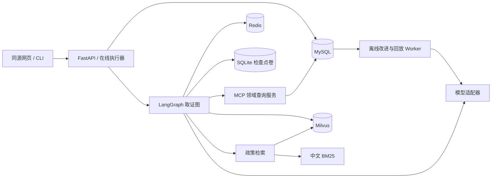
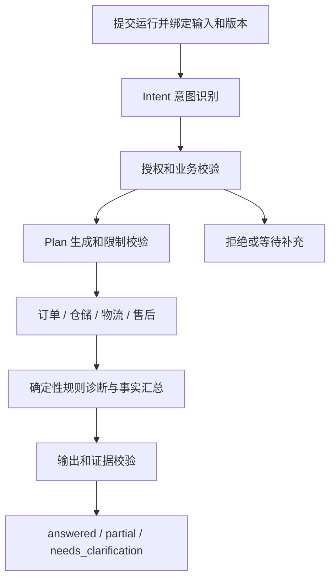

# LogiMate 技术设计

状态为开发合同。系统范围来自[已确认规格](../superpowers/specs/2026-11-19-logimate-design.md)。产品行为见 [PRD](../product/prd.md)，公开字段见 [OpenAPI](../api/openapi.yaml)。

## 部署与职责

| 组件 | 读取和写入边界 |
| --- | --- |
| `app` | 提供同源网页与 API，在单实例中执行在线图。MySQL 记录运行、事件、证据、会话和写入去重；SQLite 保存 LangGraph 检查点 |
| `mcp` | 独立容器，提供真实 Streamable HTTP 工具服务。使用只读业务连接访问合成数据 |
| `worker` | 从 MySQL 领取生成与回放任务，按租约保存结果，并恢复未结束任务 |
| MySQL | 业务记录、授权绑定、持久消息、任务、规则与技能、审计和偏好正文的权威存储 |
| Redis | 热会话窗口与摘要缓存。可按 MySQL 记录重建 |
| Milvus | 分别索引政策分块与偏好。正文、版本及当前可见性由权威记录校验 |
| 编码与生成 | CPU 本地向量编码器对政策与偏好编码。生成使用 `demo` 确定性适配器或 `deepseek` 真实适配器。两种模式调用相同业务服务 |

公开端口只有应用的回环绑定。服务版本和 Python 3.12 兼容性在阶段 01 验证并锁定。启动、配置和排障见[本地运行手册](runbook.md)。

## 在线取证

1. FastAPI 校验会话归属并记录消息，在同一 MySQL 事务中创建 `queued` 运行和幂等记录。运行固定业务数据版本、观测时点、模型模式、活动版本组合。当前活动版本的后续变化适用于新运行。
2. 协调 Agent 生成 `Intent`，包括意图类别、已确认实体、待澄清字段。校验节点应用服务端身份与工具白名单。通过后生成 `Plan`，每步包含 `step_id`、领域、工具、输入来源和依赖，拒绝未知依赖、循环和未授权工具。首版最多 12 个计划步骤，取证总预算 8 秒。
3. 四个领域 Agent 各有输入、工具和领域输出合同。订单解析实体和包裹映射，仓储汇总出库和交接，物流整理承运商事件并执行诊断规则，售后读工单并检索适用政策。无依赖的步骤并行执行，其余在前置步骤完成后执行。
4. 输出校验要求每项关键事实和诊断关联本次有效证据。状态、金额、时间及规则命中从结构化结果读取。有记录冲突时保存各自来源。模型输出失败后最多修复一次，仍失败时使用证据模板或返回明确错误。未调用过的来源、未验证的引用及模型的内部推理不得进入结果和轨迹。
5. 每个步骤入库前以 `run_id + step_id` 查找此前完成结果。将步骤、证据和审计记录一起提交；LangGraph 在节点边界保存检查点。若 MySQL 步骤先提交但检查点缺失，重放节点复用已有步骤。若检查点写入而业务步骤尚未持久完成，由恢复逻辑核对状态后重新执行该只读步骤。

MySQL `runs.status` 支持 `queued → running → completed | failed | interrupted`。应用重启时，前一进程留在 `running` 的运行标为 `interrupted`。恢复请求原子将其放回队列，使用原 `run_id` 作为 `thread_id`，并恢复原快照和已完成节点。前端使用运行状态和业务结论状态分别展示进度与结果。

## 离线 MCE 与版本治理

基于 MCE 论文对「上下文产物」与「生成产物的技能」的划分，在本系统分别实现受限规则集和结构化规则生成技能。产物由固定程序解释、校验和测试。 [MCE 论文第 3 节](https://arxiv.org/html/2601.21557#S3)

| 对象 | 必须保存的内容 |
| --- | --- |
| 规则集 | 规则 ID、作用范围、优先级、条件树、诊断分类、证据要求、反馈来源、规范化内容哈希 |
| 技能 | 父技能、反馈筛选、错误归类、证据选择、生成指令、预期反例、来源报告、变更理由、内容哈希 |
| 版本组合 | 按租户关联不可变的规则与技能，记录父版本、提交者、候选内容哈希和所依据的活动发布 ID |
| 回放报告 | 比较类型、数据及配置哈希、基线和候选、模型模式、案例数及逐案例结果、重点用例变化 |
| 发布事件 | 前后活动组合、审核人、操作者、事件类型、理由、时间和独立发布 ID |

**基础层。** 读取复核后的反馈与同租户改进轨迹。当前技能指导生成结构化增量。条件树支持 `all`、`any` 组合及字段白名单比较。字段缺失需显式判断；存在同优先级的冲突匹配、无证据分类或来源无效时拒绝候选。候选通过固定校验后在开发验证集回放。

**元层。** 从同租户历史规则、技能与报告提炼成功与失败模式。候选技能必须能指出修改的生成步骤或反例要求。固定基础层模型、预算、数据和起始规则，分别执行旧技能与候选技能并比较产物，形成 `skill_ablation` 报告。候选技能随候选规则参与审核和激活，下一次改进可以实际引用该技能。

**激活前。** 生成单独的 `active_baseline` 报告，以当前活动规则为基线。采用候选要求错误率严格下降、权限和证据用例全部通过、重点案例无新增错误。候选 `draft → replaying → passed | failed`。审核员可把 `passed` 变为 `approved` 或 `rejected`。同基线重新回放时保留原报告和审计，原审批失效。基线过期时，以现行发布 ID 创建引用原规则与技能产物的新候选，保留版本关系，并重新回放与审核。

**激活与回滚。** 在 MySQL 事务内锁定本租户的活动指针，验证调用方、候选状态、审批绑定的 `reviewed_report_id`、内容哈希和预期发布 ID。更新指针并写独立事件。发布后候选转为 `released`；是否当前启用由活动指针表示。回滚到同租户此前发布的明确组合，追加回滚事件。操作员及审核员身份分离。

离线任务以 `queued → running → completed | failed` 表示运行情况。回放正常结束、候选未达标时任务为 `completed`。每次领取任务发新租约，只有有效租约可确认当次进度。逐案例以候选、数据快照、配置和案例 ID 去重。强制结束 worker 后新租约接手未完成部分。

## 检索和记忆

| 处理 | 细节 |
| --- | --- |
| 政策入库 | 使用合成 Markdown 政策，以标题、条款和段落分块。目标每块 150–450 中文字符。正文与标题路径供编码、检索和引用；版本与生效窗口用于过滤 |
| 双路召回 | 本地中文 BM25 与 Milvus 稠密召回并行各取 20 条，按 RRF 合并取 5 条。两条路径使用同一文档版本、可见性和适用日期 |
| 800 ms 预算 | 从检索入口到选定结果，覆盖编码、召回和融合。两路完成时返回 `hybrid`；稠密路径超时或失败且关键词可用时返回 `keyword_only`；仅稠密可用为 `semantic_only`；其余为 `unavailable` |
| 短期 | Redis 按租户、用户、会话保存最近 12 条消息和摘要。超出 token 预算时压缩较旧消息；持久消息、摘要版本和引用仍由 MySQL 保存 |
| 长期 | 用户主动保存偏好。写 MySQL 后异步索引 Milvus，记录索引状态。从当前主体范围按语义取候选后，回读 MySQL 复核偏好仍有效。撤回先使 MySQL 失效，然后清索引 |

## 数据主键和一致性

| 数据组 | 关系及唯一性 |
| --- | --- |
| 业务快照 | `orders`、`packages`、`warehouse_events`、`tracking_events`、`aftersales_cases` 使用租户、数据版本和领域 ID。订单到包裹一对多，事件同时存业务发生时间和系统可见时间。仅返回观测时点前可见的数据 |
| 会话和运行 | 会话记录所有者，运行归属会话。消息与步骤引用运行，步骤唯一键为 `tenant_id, run_id, step_id`。证据快照按来源记录定位，单独保存运行与证据的关联 |
| 纠正和改进 | 反馈关联原运行和允许的证据。任务、报告和版本租户一致。一个租户一个活动指针。报告比较类型、基线和候选哈希随报告冻结 |
| 策略与用户数据 | `rule_versions`、`skill_versions` 和发布事件保留历史。偏好按租户和用户绑定。幂等表按租户、用户、方法、路径、键记录请求哈希及原结果 |
| 索引和检查点 | Milvus 把索引版本及权威 ID 随向量存储；Redis 只缓存有界上下文；SQLite 检查点单机持久化，启用限制反序列化的配置 |

可写数据使用迁移创建和升级。关键诊断字段、事件状态和版本 ID 使用结构化列或校验后的 JSON；版本差异、快照和回放明细保留格式版本。提交失败后靠唯一键和状态校验重试。初次初始化与重复播种分别验收。

## 网页实现约定

FastAPI 同源提供 HTML、CSS 和原生 JavaScript。排查页渲染结构化结论与证据，改进页渲染候选差异和审批，复测页读取公开归档。按[接口约定](../api/README.md)轮询、处理权限和重试。模型输出、工单说明和政策正文当作数据以文本节点渲染；时间、金额和证据由类型化字段格式化。页面在加载、部分结果、待补充、失败和操作成功时都有可辨识的状态。
